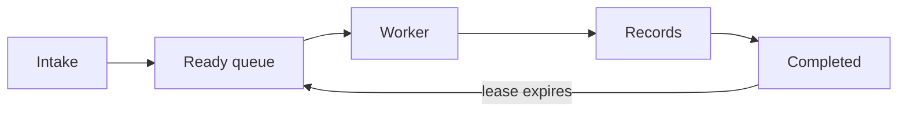

# Processing

The intake service accepts a bundle and puts a job in the ready queue. A worker
claims the job with a lease. It writes records, then acknowledges completion.
Expired leases return jobs to the ready queue. A checkpoint controls the effective
window; multiply the window by the stride to determine eligible work.

The processing path is shown above.
